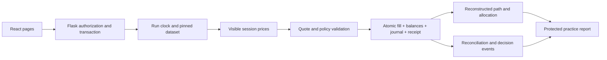

# Architecture and invariants

`frontend/src/App.jsx` connects React Router pages to relative `/api` requests. Recharts uses only the visible market observations. Authentication is never read from localStorage. The Vite development proxy serves `/api` from Flask; the production Flask app serves `frontend/dist` and `/api` on one origin.

`backend/app.py` owns the application factory, authorization, quote signing and transactional HTTP routes. `backend/db.py` defines the SQLAlchemy Core schema; `migrations.py` applies numbered upgrades. `accounting.py` owns journal entries and reconciliation. `replay.py` loads only observations through the server-controlled clock from immutable dataset tables. `analytics.py` reconstructs portfolio paths and risk measures using Decimal. `scenario_data.py` seeds three original synthetic datasets. `content.py` holds educational drafts. `market.py` is the isolated optional Yahoo adapter.

New React components separate portfolio analysis, outcome charts, learning history and account history from page routing. Recharts is loaded on demand. The original source under `legacy/` is reference only.

## Identity

The browser receives an opaque, HttpOnly, SameSite=Lax cookie; the database stores only its SHA-256 digest. Server session rows contain the user ID, expiry, CSRF token and optional isolated demo-family capability. Login, logout and role switching rotate the session and CSRF token. Sessions expire after 12 hours. Production requires secure HTTPS cookies and a configured secret. Every mutation needs the server-issued CSRF token and JSON; foreign origins are rejected. Passwords and child PINs use Werkzeug's scrypt hashing. Login limits count both hashed source address and hashed login identity, across server restarts: ten attempts in fifteen minutes. Failed authentication retains those counters while ordinary failed trades roll back.

Parents own linked child profiles; child ownership is resolved through the authenticated user, never request-supplied role or family. Family codes identify a family but do not authenticate the child without the protected PIN. The demo creates an independent fictional family per browser session; switching requires that session's demo capability and rejects IDs outside it. Normal account sessions cannot use this capability. Sign out and start another demo for a fresh isolated family; use a private browser context for simultaneous independent demos.

## Relational records

Families → users → policies, runs, lesson progress, immutable lesson attempts, watchlists and goals. Runs → positions, orders, immutable fills, cash/position journal and reflections. Orders → immutable decision events. Dataset → dated sessions → ticker closing prices. Composite foreign keys link prices to actual dataset sessions. A partial unique index permits one active run per child/mode/dataset. Parent review gathers orders across the selected child's runs. Reset preserves the same dataset in its replacement. [Full database design](DATABASE.md) documents adoption of old databases and backup behavior.

## Precision and execution

Prices, cash, amounts and cost basis are stored as decimal strings, not SQLite floating-point values. All accounting uses Python `Decimal`, default precision 28. Dollar inputs must be finite, positive (or zero for configurable caps), at most $1,000,000, and exactly cent-denominated. Displayed and posted dollars use `ROUND_HALF_UP` to cents. Dollar-denominated orders become shares rounded **down** to eight decimal places; the executed quantity × trusted price is then rounded half-up to cents. Any sub-cent trade is rejected. These rounding conventions can cause a tiny difference from the requested nominal dollar amount. Sell basis is removed proportionally, rounded to cents, with the entire remaining basis removed on an exact liquidation. Cash and holdings never go negative.

Positions are long-only. No leverage, shorting, derivatives, real brokerage, banks or payments exist. A signed ten-minute quote binds run ID, ticker, session and trusted price. Parent approvals use the original displayed quote; advancing a session or expiring the quote returns a reconfirmation error. The child can explicitly reconfirm at the newly displayed price. Browser-supplied prices are ignored. Pending proposals reserve no funds; approval rechecks holdings, cash, limits, pause and quote.

Gross daily buys sum Decimal fill amounts selected through an indexed run join, including archived runs and other replay datasets for the same child/mode/date. Switching scenarios or resetting cannot restore the allowance. Sandbox uses UTC calendar dates; replay uses illustrative session dates. Replay and sandbox have separate daily accounting.

SQLite write requests use `BEGIN IMMEDIATE`: cash, position changes, fill insertion, terminal order state and retry receipt commit atomically under the same write lock. A fill's order ID is unique. Idempotency keys are scoped to authenticated user and endpoint, with a canonical request-payload hash; retrying with different data returns a conflict. Terminal approvals cannot execute again, including concurrent requests with different keys. Replay advancement additionally requires an expected session; duplicate keys return the original result and new keys with a stale expected session fail. The frontend retains an unresolved mutation's key for a network retry.

## Replay and comparisons

The full synthetic series resides in the backend database. Market queries restrict dated observations and prices to `session <= run.session`, before constructing any API response. Future-session requests and trade payloads fail. Each scenario has its own persisted clock and session count. At its final session new trades are disabled; archived runs cannot trade or advance.

Valuation uses cash plus quantity × the same-session closing prices. The benchmark invests all starting virtual funds in fractional VTI at session zero and holds; it uses matching dates and the same price convention, without interim contributions, dividends, fees, taxes or cash interest. Gain includes realized and unrealized effects; the holdings table's gain is specifically unrealized. Both benchmark and portfolio are educational comparisons, not scores for reasoning quality.

## Known limits

Analysis reconstructs end-of-session cash and quantities from executed fills, rather than repricing today's holdings backwards. It includes sales on their actual session, matches current valuation and reports realized sale proceeds minus removed basis, remaining unrealized gain, allocation including cash, and maximum observed peak-to-trough decline. Starting capital is the initial peak. No annualized risk or prediction score is presented. Practice reports run within one read transaction, omit execution quote tokens and never include future observations.

Single-host SQLite supports local practice and a small persistent-disk deployment. Numbered migrations are forward-only; restore a consistent backup and matching application version to roll back. There is no password recovery, email verification, administrator portal, automatic expiry cleanup, account deletion UI or production abuse-monitoring system. Free-text exercises use a minimum-length completion rule, not an assessment of reasoning quality. Immutable database triggers protect normal writes, not a privileged administrator replacing the database. The optional predictor remains unavailable without a reviewed artifact.
